# ABDM Connect — Healthcare Interoperability Platform

Consent-based health data exchange between laboratories, hospitals and patients, built on FHIR R4:

1. A **laboratory (HIP)** registers a patient and records a blood-test report with LOINC-coded results.
2. A **hospital doctor** records outpatient consultations: complaint, examination, vitals, diagnosis,
   prescription and follow-up. The patient sees every report and consultation in their portal.
3. Every record is available as a **FHIR R4 document Bundle**, validated against base R4.
4. Hospitals are **both HIP and HIU**: a hospital requests a lab report or another hospital's
   consultation for a stated purpose, and the **patient** approves, denies or later revokes.
5. A record is released **only** while the backend confirms an active, unexpired consent that matches
   facility, record and purpose. Each facility's *Shared records* page shows who requested its records.
6. Every important action, including every refusal, is written to an **audit log**.

> **Status: test environment.** The application is **not yet connected to ABDM** and is not certified
> by ABDM / NHA. Patient IDs (`PAT-…`) are issued by this application and are not ABHA numbers.
> Do not enter real patient data until the steps in
> [How to make it a real ABDM system](#how-to-make-it-a-real-abdm-system) are complete.

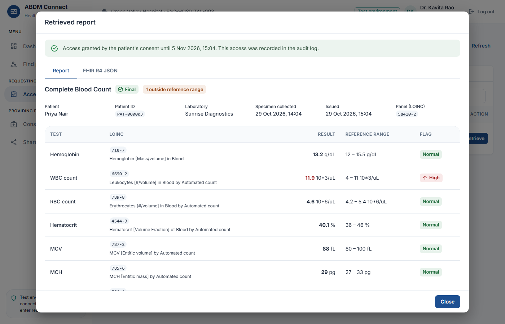

---

## Screenshots

<table>
  <tr>
    <td width="50%">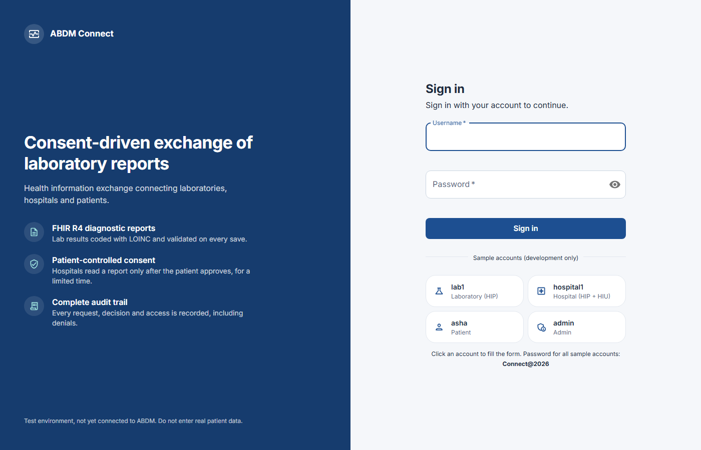<br><b>Login</b>: sample accounts fill the form</td>
    <td width="50%">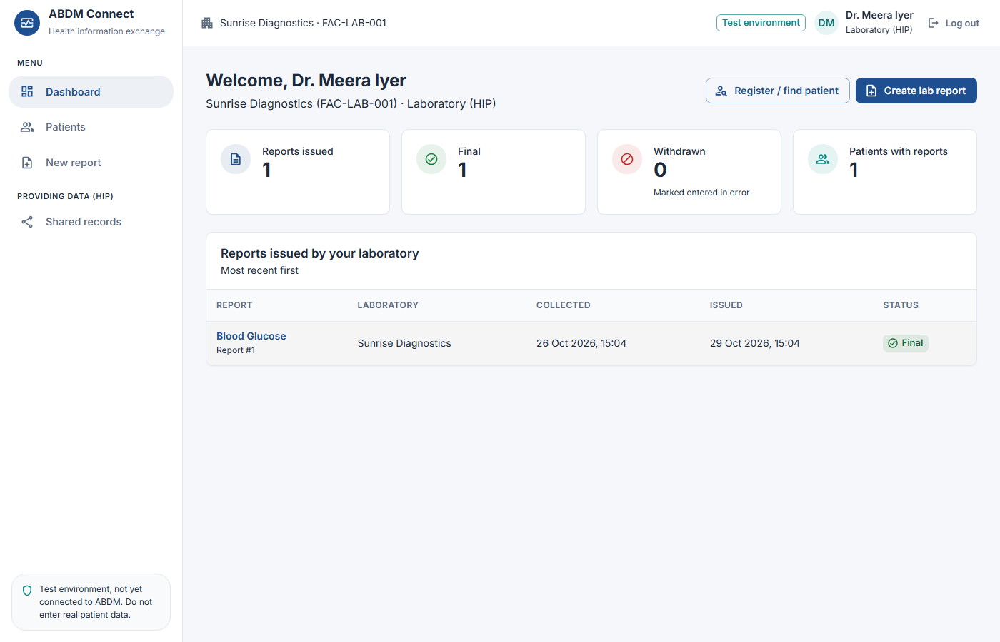<br><b>Lab dashboard</b></td>
  </tr>
  <tr>
    <td>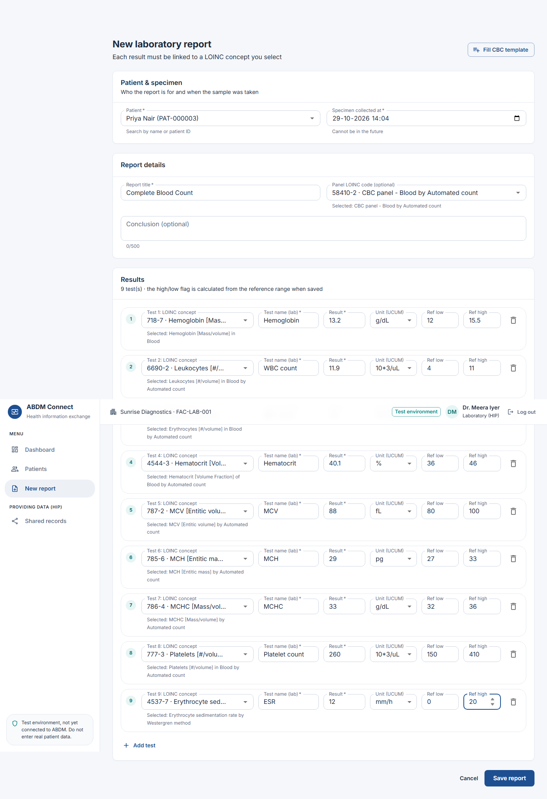<br><b>Report form</b>: LOINC-coded tests with units and reference ranges</td>
    <td>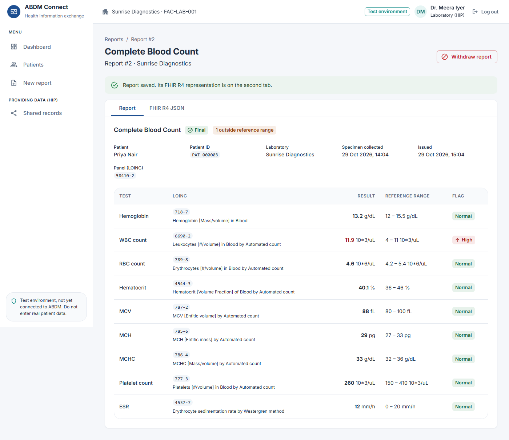<br><b>Report view</b>: results flagged low / normal / high</td>
  </tr>
  <tr>
    <td>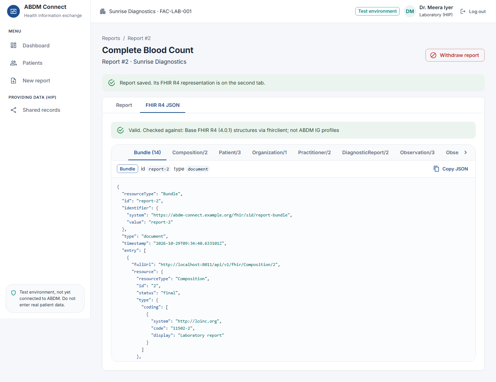<br><b>FHIR R4 viewer</b>: the report as a FHIR document Bundle</td>
    <td>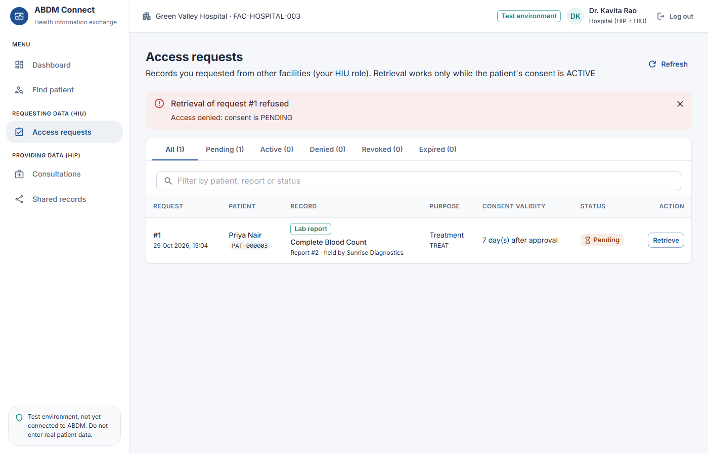<br><b>Hospital request</b>: denied while consent is pending</td>
  </tr>
  <tr>
    <td>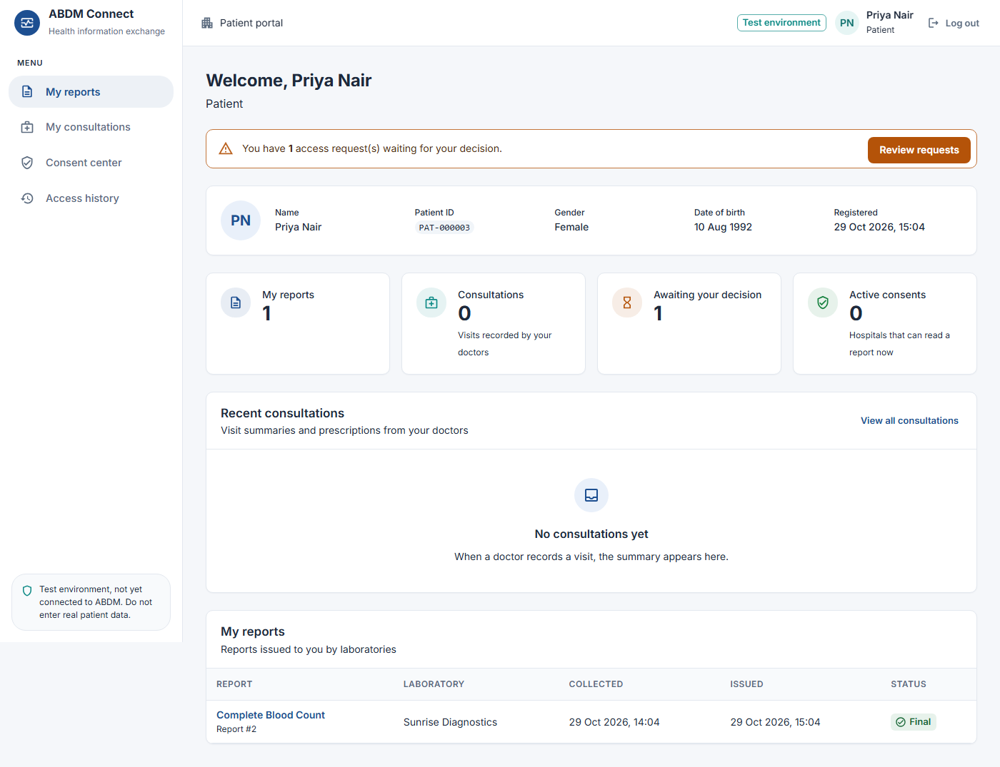<br><b>Patient portal</b>: the patient's own reports</td>
    <td>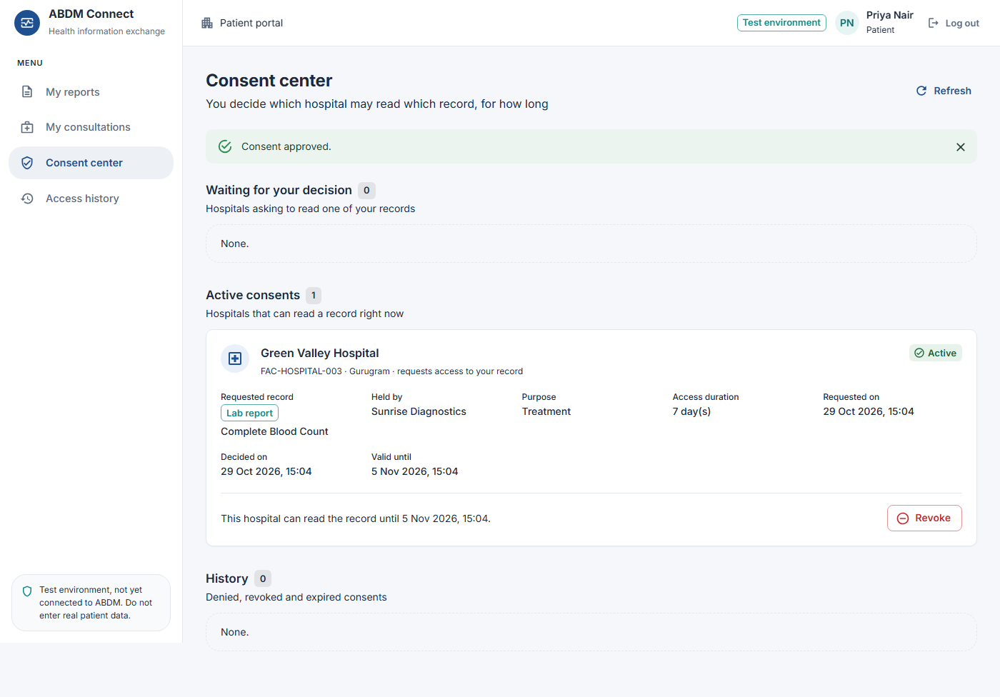<br><b>Consent center</b>: the patient approves the request</td>
  </tr>
  <tr>
    <td><br><b>Record retrieved</b>: released only with active consent</td>
    <td>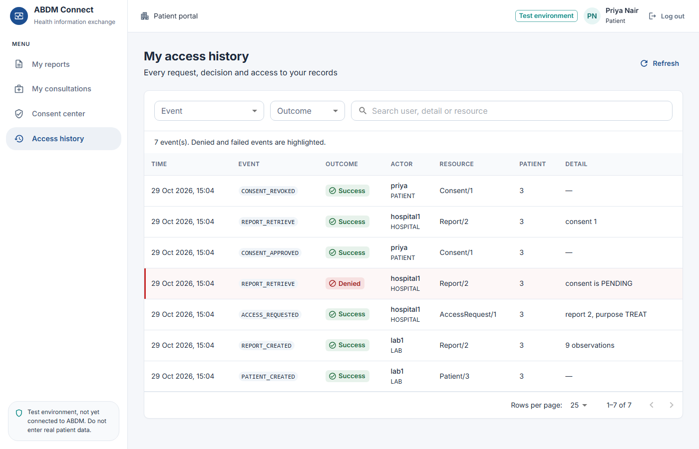<br><b>Access history</b>: the patient sees who viewed their data</td>
  </tr>
  <tr>
    <td>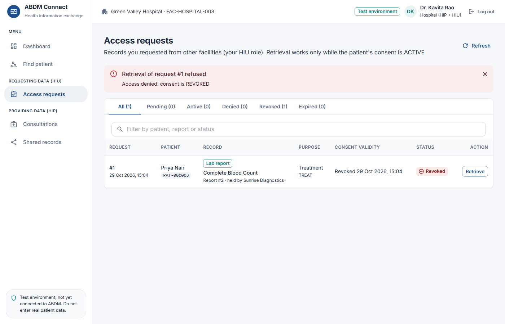<br><b>Consent revoked</b>: access is denied again</td>
    <td>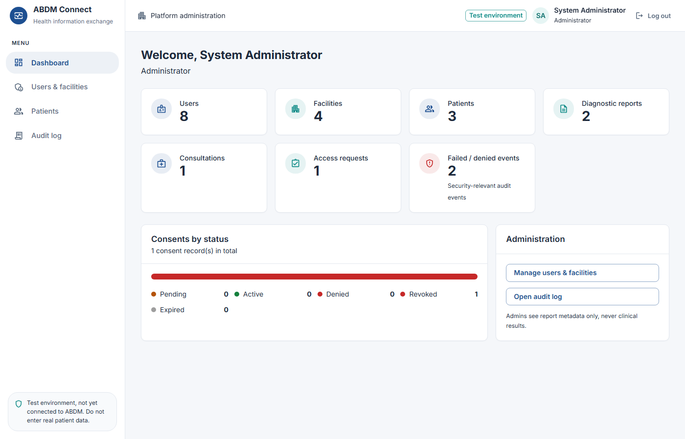<br><b>Admin dashboard</b></td>
  </tr>
  <tr>
    <td>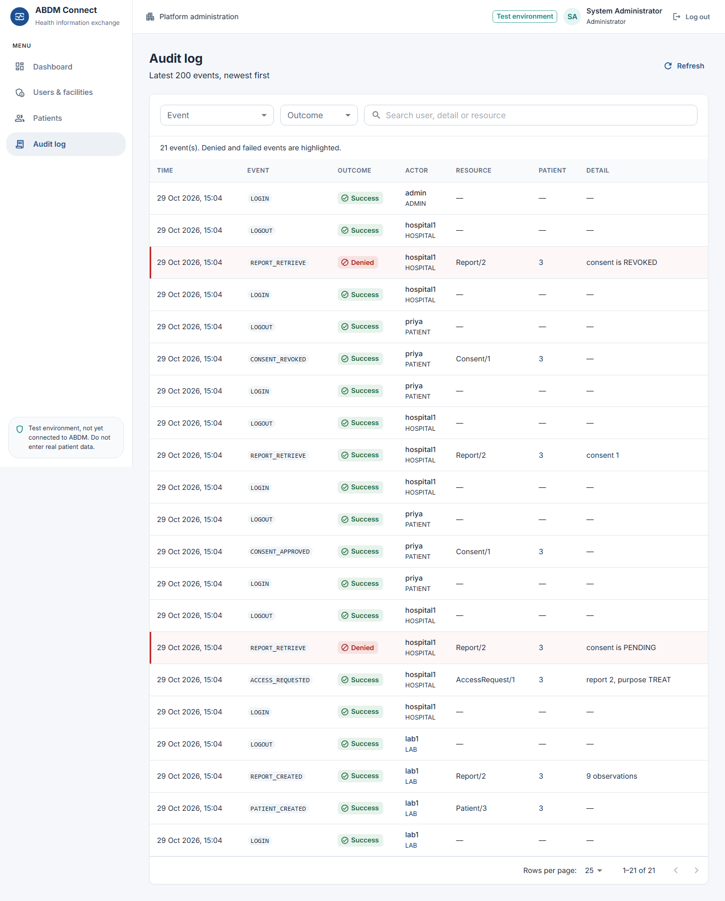<br><b>Audit log</b>: every action, including refusals</td>
    <td>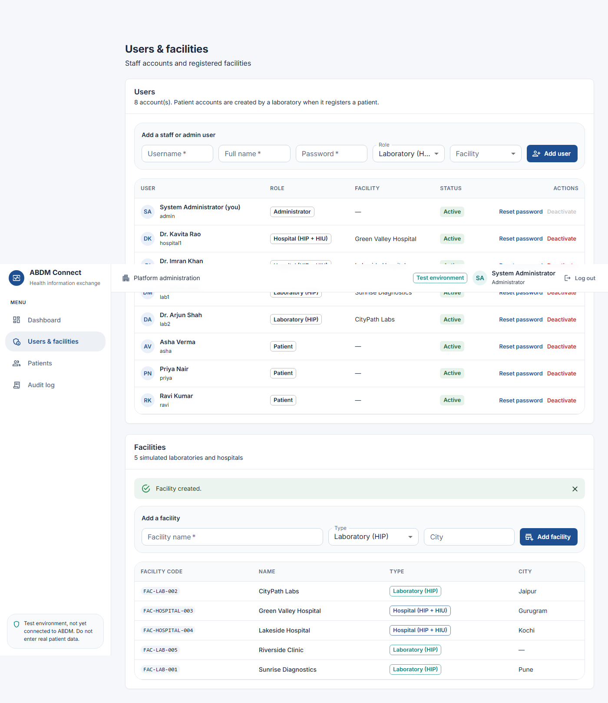<br><b>Users &amp; facilities</b></td>
  </tr>
</table>

---

## Contents

- [Screenshots](#screenshots)
- [How to make it a real ABDM system](#how-to-make-it-a-real-abdm-system)
- [What is simulated and what is standard](#what-is-simulated-and-what-is-standard)
- [Architecture](#architecture)
- [Requirements](#requirements)
- [Setup on Windows (PowerShell)](#setup-on-windows-powershell)
- [Sample accounts](#sample-accounts)
- [Walk-through](#walk-through)
- [Running the tests](#running-the-tests)
- [Project structure](#project-structure)
- [Key design decisions](#key-design-decisions)
- [FHIR details](#fhir-details)
- [LOINC data and licence](#loinc-data-and-licence)
- [Security notes](#security-notes)

API reference: [docs/API.md](docs/API.md) · Production plan: [docs/PRODUCTION_PLAN.md](docs/PRODUCTION_PLAN.md) ·
FHIR samples: [docs/fhir-examples/](docs/fhir-examples) · Screenshots: [docs/screenshots/](docs/screenshots)

---

## How to make it a real ABDM system

The full plan, with sources, is in [docs/PRODUCTION_PLAN.md](docs/PRODUCTION_PLAN.md). In short:

### What you must do (cannot be done in code)

| # | Step | Why |
|---|---|---|
| 1 | Have a **legal entity** and a person responsible for data protection | Someone must sign agreements and own compliance |
| 2 | Get **legal advice** on the DPDP Act 2023, DPDP Rules 2025 and ABDM's health data policies | Consent, security and breach-notification duties apply to health data |
| 3 | Register every facility in the **Health Facility Registry (HFR)** | Real facilities are identified by HFR IDs |
| 4 | Register every doctor in the **Healthcare Professionals Registry (HPR)** | Real doctors are identified by HPR IDs |
| 5 | Register the software on the **ABDM sandbox** to receive a **client ID and secret** | Needed for every ABDM API call. Keep them only in `backend/.env` or a secret manager |
| 6 | Get a **server with a public HTTPS address** (domain + TLS) | ABDM calls the HIP/HIU endpoints back; `localhost` cannot be used |
| 7 | Arrange **terminology access**: LOINC (check licence terms) and SNOMED CT | ABDM FHIR profiles expect coded diagnoses and medicines |

### What gets built (code)

| Phase | Work |
|---|---|
| 1. Security hardening | PostgreSQL + Alembic migrations; mandatory strong secrets; httpOnly cookie sessions with refresh tokens; password policy, rate limiting, lockout, MFA; no sample accounts in production; tamper-evident audit log; HTTPS and security headers; encrypted backups; an independent security test |
| 2. Real identities and coded data | ABHA number/address on patients, HFR IDs on facilities, HPR IDs on doctors; SNOMED CT and drug codes; FHIR rebuilt to the **NRCeS ABDM FHIR Implementation Guide** (`DiagnosticReportRecord`, `OPConsultRecord`) and validated against its profiles |
| 3. ABDM **M1** — identity | Gateway session, ABHA creation and verification, ABHA-based registration |
| 4. ABDM **M2** — HIP | Care contexts for each report and consultation, discovery and linking callbacks, encrypted data push (ABDM's Fidelius scheme: ECDH Curve25519, HKDF-SHA256, AES-256-GCM) |
| 5. ABDM **M3** — HIU | Consent requests through the ABDM consent manager (patients approve in their ABHA app), receiving and decrypting data, honouring consent expiry |
| 6. Certification and go-live | Pass the sandbox test cases, complete ABDM certification, receive production credentials, pilot at one facility |

Integrator guides estimate roughly **4–6 months** from sandbox to production when adding ABDM to an
existing system. Treat that as a rough figure. Remove the "Test environment" notice only after phase 6.

### Suggested order

1. Start steps 1–6 above now; registrations and legal review take the longest.
2. Build phase 1 (needs nothing from ABDM), then phase 2.
3. With sandbox credentials, build phases 3 → 4 → 5.
4. Certify, pilot, and only then go live.

## What is simulated and what is standard

| Area | Status |
|---|---|
| Patient identity | **Local.** IDs `PAT-000001` issued by this application. No ABHA numbers or addresses yet. |
| Facilities, HIP / HIU roles | **Local.** Facility codes `FAC-…`; not yet registered in HFR. Labs are HIP; hospitals are HIP and HIU. |
| Consent workflow | **Simulated** locally (PENDING → ACTIVE / DENIED, ACTIVE → REVOKED / EXPIRED). *Modelled on* the ABDM Consent Manager but does **not** use its APIs or message formats yet. |
| Data transfer | **Simulated** as a direct API call after a consent check. No encryption keys, callbacks or gateway yet. |
| API paths | This application's own REST design (`/api/v1/...`). **Not** ABDM gateway endpoints. |
| FHIR resources | **Standard HL7 FHIR R4** JSON, validated against **base R4** structures: lab reports (Composition, DiagnosticReport, Observation) and consultations (Composition *Consult note*, Encounter, Condition, Observation, MedicationRequest, Appointment). |
| ABDM FHIR profiles | **Not yet claimed.** Shaped with the [ABDM FHIR Implementation Guide](https://nrces.in/ndhm/fhir/r4/StructureDefinition-OPConsultRecord.html) in mind, not validated against its profiles. |
| Terminology | **Standard** LOINC codes (local subset) and UCUM units; HL7 terminology for categories, interpretation and purpose-of-use. Diagnoses and medicines are free text for now. |

All consent rules live in one function (`backend/app/services.py → consent_problem`) and all FHIR
building lives in `backend/app/fhir.py`, so the ABDM connector can replace the local flow cleanly.

## Architecture

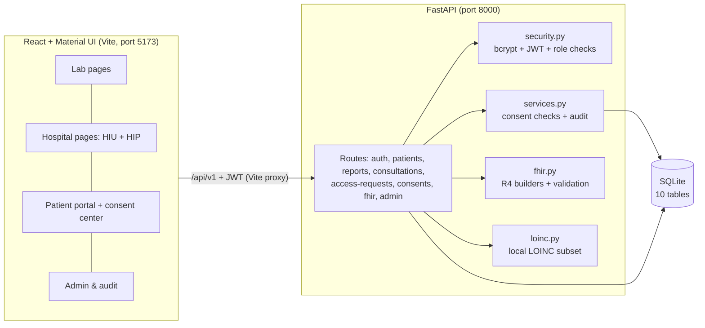

Request path for a hospital reading another facility's record:

```
Hospital clicks "Retrieve"
  → POST /access-requests/{id}/retrieve  (JWT identifies user, role and facility from the DB)
  → services.consent_problem(): facility? record scope? patient? ACTIVE? not expired? purpose? not withdrawn?
      ├─ problem → audit ..._RETRIEVE DENIED → 403 "Access denied: <reason>"
      └─ ok      → audit ..._RETRIEVE SUCCESS → record + FHIR Bundle + validation result
```

Database tables: `users`, `facilities`, `patients`, `reports`, `observations`, `consultations`,
`medications`, `consents`, `access_requests`, `audit_events` (see `backend/app/models.py`).

## Requirements

| Tool | Version |
|---|---|
| Windows | 10 or 11, PowerShell 5.1 or 7 |
| Python | **3.11 – 3.14** |
| Node.js | **22 LTS** (22.12 or newer) or 20.19+ — required by Vite 8 |
| npm | comes with Node.js |

No Docker, no cloud services. Everything runs on `localhost`.

## Setup on Windows (PowerShell)

> If PowerShell refuses to run the activation script, run this once:
> `Set-ExecutionPolicy -Scope CurrentUser RemoteSigned`

### 1. Get the project

```powershell
cd C:\path\to\abdm-connect
```

### 2. Backend: virtual environment, dependencies, database, sample data

```powershell
cd backend
py -3.13 -m venv .venv            # or: python -m venv .venv
.\.venv\Scripts\Activate.ps1
python -m pip install --upgrade pip
pip install -r requirements.txt
Copy-Item .env.example .env        # then edit .env and set a long random JWT_SECRET
python -c "import secrets; print(secrets.token_urlsafe(48))"   # prints a value you can paste as JWT_SECRET
python -m app.seed                 # creates abdm_connect.db with tables and sample data
```

`python -m app.seed --reset` deletes all data and recreates the sample data.

**Upgrading an existing database:** at startup the backend upgrades older databases in place
(`backend/app/migrations.py`) and first saves a copy next to it (`abdm_connect.db.bak-…`).

### 3. Start the backend (terminal 1)

```powershell
cd C:\path\to\abdm-connect\backend
.\.venv\Scripts\Activate.ps1
uvicorn app.main:app --reload --port 8000
```

API docs: <http://localhost:8000/docs>

### 4. Frontend: install and start (terminal 2)

```powershell
cd C:\path\to\abdm-connect\frontend
npm ci                             # installs exactly the versions in package-lock.json
Copy-Item .env.example .env        # optional; the default already works
npm run dev
```

Open <http://localhost:5173>. The Vite dev server forwards `/api` to the backend on port 8000.

### 5. Run the tests

```powershell
cd C:\path\to\abdm-connect\backend
.\.venv\Scripts\Activate.ps1
pytest -q
```

## Sample accounts

Created by `python -m app.seed` for development and testing. **All use the password `Connect@2026`.**
The login page lists them only on the development server (`npm run dev`), never in a production build.
Never create these accounts on a production server.

| Username | Role | Facility / record |
|---|---|---|
| `admin` | Administrator | — |
| `lab1` | Laboratory (HIP) | Sunrise Diagnostics |
| `lab2` | Laboratory (HIP) | CityPath Labs — used to test cross-facility blocking |
| `hospital1` | Hospital (HIP + HIU) | Green Valley Hospital |
| `hospital2` | Hospital (HIP + HIU) | Lakeside Hospital |
| `asha` | Patient | Asha Verma, PAT-000001 (sample glucose report and consultation) |
| `ravi` | Patient | Ravi Kumar, PAT-000002 |

New patients get their own login when a lab registers them (the lab sets a temporary password).

## Walk-through

Start from fresh data with `python -m app.seed --reset`. Screenshots are in [docs/screenshots](docs/screenshots).

| # | Step | Where |
|---|---|---|
| 1 | Log in as `lab1`. | Login page (sample accounts fill the form) |
| 2 | **Patients → Register patient**: e.g. *Priya Nair*, 1992-08-10, username `priya`, password `Priya@123`. | A `PAT-…` ID is shown |
| 3 | **Create report → Fill CBC template**, enter the 8 results, optionally **Add test** and search `ESR`. | Report form |
| 4 | Each row's LOINC concept is picked from search results (by name, abbreviation such as `Hb`, or code). | LOINC picker |
| 5 | **Save report**, then open the **FHIR R4 JSON** tab. | Report page |
| 6 | Log in as `hospital1`. **Find patient → Priya → Open → Request access** (purpose *Treatment*, 7 days). | Patient page |
| 7 | **Access requests → Retrieve** shows *Access denied: consent is PENDING*. | Access requests |
| 8 | Log in as `priya` → **Consent center → Approve**. | Consent center |
| 9 | Log in as `hospital1` → **Retrieve**: report and FHIR Bundle are shown. | Retrieved report dialog |
| 10 | Log in as `admin` → **Audit log**: `REPORT_RETRIEVE` SUCCESS and the earlier DENIED. | Audit log |
| 11 | As `priya` → **Revoke**. As `hospital1` → **Retrieve** → *Access denied: consent is REVOKED*. | |
| 12 | Consultations: as `hospital1`, **Find patient → New consultation**, save it; log in as the patient → **My consultations**. | Consultation pages |
| 13 | HIP + HIU: as `hospital2`, open Asha → **Consultations at other hospitals → Request access**; as `hospital1` see it under **Shared records**; as `asha` approve; as `hospital2` retrieve. | |

### Optional: automated browser walk-through

`tools/e2e_acceptance.py` clicks through steps 1–11 in a headless browser and saves screenshots.
With both servers running on fresh sample data:

```powershell
cd C:\path\to\abdm-connect
backend\.venv\Scripts\Activate.ps1
pip install playwright
playwright install chromium
python tools/e2e_acceptance.py docs/screenshots
```

## Running the tests

`backend/tests` (pytest + FastAPI TestClient, a temporary SQLite database per test):

| File | Covers |
|---|---|
| `test_auth.py` | login success/failure (+ audit), bad/expired tokens, logout invalidation, deactivated users, role permissions, admin user/facility management |
| `test_reports_fhir.py` | patient registration, report creation and validation, LOINC consistency, cross-facility and cross-patient access, FHIR Bundle validity, FHIR read endpoints, withdrawn reports |
| `test_consent.py` | approve → retrieve → revoke, deny, invalid transitions, expiry, cross-facility hospital, purpose mismatch, single-record scope, duplicates, audit |
| `test_consultations.py` | doctor creates, patient reads, access only for the writing hospital and the patient, validation, FHIR bundle validity, withdraw |
| `test_hip_hiu.py` | hospital requests another hospital's consultation, hospital as HIP and HIU at once, request rules, upgrades of older databases |

## Project structure

```
abdm-connect/
├── backend/
│   ├── app/
│   │   ├── main.py          FastAPI app, CORS, routers, startup upgrades
│   │   ├── config.py        settings from environment / .env
│   │   ├── database.py      engine, session, UTC datetime column
│   │   ├── models.py        the 10 SQLAlchemy tables
│   │   ├── migrations.py    in-place upgrades of older databases (with backup)
│   │   ├── schemas.py       Pydantic request/response models and validation
│   │   ├── security.py      bcrypt, JWT, current user, role checks
│   │   ├── services.py      audit(), consent state changes, consent checks, record visibility
│   │   ├── fhir.py          FHIR R4 builders (reports, consultations) and validation
│   │   ├── loinc.py         LOINC subset search
│   │   ├── seed.py          create tables + sample data
│   │   ├── data/            loinc_subset.csv, LOINC_NOTICE.txt
│   │   └── routes/          auth, patients, reports, consultations, consent, fhir_routes, admin
│   ├── tests/               pytest suite
│   ├── requirements.txt, pytest.ini, .env.example
├── frontend/
│   ├── src/
│   │   ├── main.jsx         theme + router
│   │   ├── App.jsx          auth context, navigation per role, routes
│   │   ├── api.js           axios with token + session-expiry handling
│   │   ├── components.jsx   shared UI: FHIR viewer, tables, dialogs, loaders, status chips
│   │   └── pages/           Login, Dashboard, Patients, PatientDetail, ReportForm, ReportView,
│   │                        Consultations, ConsultationForm, ConsultationView, AccessRequests,
│   │                        SharedRecords, ConsentCenter, AuditLog, Admin
│   ├── package.json, package-lock.json, vite.config.js, .env.example
├── docs/                    API.md, PRODUCTION_PLAN.md, fhir-examples/, screenshots/
└── tools/e2e_acceptance.py  optional browser walk-through
```

## Key design decisions

- **One place for consent rules.** `consent_problem()` returns the reason access is refused, or `None`.
  The retrieve endpoint calls it on *every* request, so a status shown in the browser never grants access.
- **Nothing important comes from the browser.** Role, facility and patient link are loaded from the
  database for the token's user. The patient of an access request is taken from the record itself.
- **Access request status = consent status**, so the two can never disagree.
- **Consent scope is one record** (a lab report or a consultation) for one requesting facility and one
  purpose, for 1–30 days from approval. Before consent, a requesting hospital sees only metadata
  (title or visit date, facility, doctor), never clinical content.
- **The holding facility (HIP) never approves.** Only the patient decides; the HIP sees requests on
  *Shared records*.
- **Expiry without a background job.** An ACTIVE consent past `expires_at` becomes EXPIRED (and is
  audited) the next time it is read; the time check also blocks access before that.
- **Logout that really works with JWT.** Each user has a `token_version`; logout or a password reset
  increments it, which invalidates every earlier token.
- **Admins never see clinical data.** Labs see only their own reports; hospitals see their own
  consultations and other facilities' records only through consent.
- **404 instead of 403** where the existence of someone else's record should not be revealed.
- **Schema changes** are applied by `migrations.py` with an automatic backup. Alembic is planned for production.

## FHIR details

**Lab report** (`GET /reports/{id}/fhir`) — document Bundle: Composition (LOINC `11502-2` Laboratory
report), Patient, Organization, Practitioner, DiagnosticReport (category `LAB`), Observations (LOINC
code + display, UCUM `valueQuantity`, reference range, interpretation `L`/`N`/`H`).

**Consultation** (`GET /consultations/{id}/fhir`) — document Bundle: Composition (LOINC `11488-4`
Consult note) with sections for chief complaints, physical examination, diagnosis, medications and
plan; Encounter (ambulatory), Conditions, vital-sign Observations (LOINC + UCUM), MedicationRequests
and a follow-up Appointment.

Patient identifiers use the system `https://abdm-connect.example.org/fhir/sid/patient-id`. Replace
`example.org` with your own domain before production.

**Validation:** each resource is loaded into the `fhirclient` R4 (4.0.1) models in strict mode (data
types, required and unknown elements). The app also checks that every reference resolves inside the
Bundle and that it starts with a Composition. It does not evaluate FHIRPath invariants, terminology
bindings or ABDM IG profiles; that is phase 2 of the production plan.

## LOINC data and licence

`backend/app/data/loinc_subset.csv` holds a hand-curated subset (44 common lab concepts and 5 panels).
LOINC is free to use and redistribute under the [LOINC licence](https://loinc.org/license) with the
notice in `backend/app/data/LOINC_NOTICE.txt`. Verify codes against the official LOINC release before
clinical use; the full table can be loaded in the same CSV format.

## Security notes

Implemented: bcrypt password hashing, JWT with expiry and server-side invalidation, role and
ownership checks on every protected endpoint, protection against cross-patient / cross-facility
access and consent bypass, CORS limited to the frontend origin, secrets from `.env`, an audit log
without passwords, tokens or clinical values, and input validation with readable errors.

Still required before real patient data: everything in phase 1 of
[How to make it a real ABDM system](#how-to-make-it-a-real-abdm-system) (PostgreSQL, secure cookies,
MFA, rate limiting, tamper-evident audit log, HTTPS, backups, security testing) and a legal and privacy
review.
